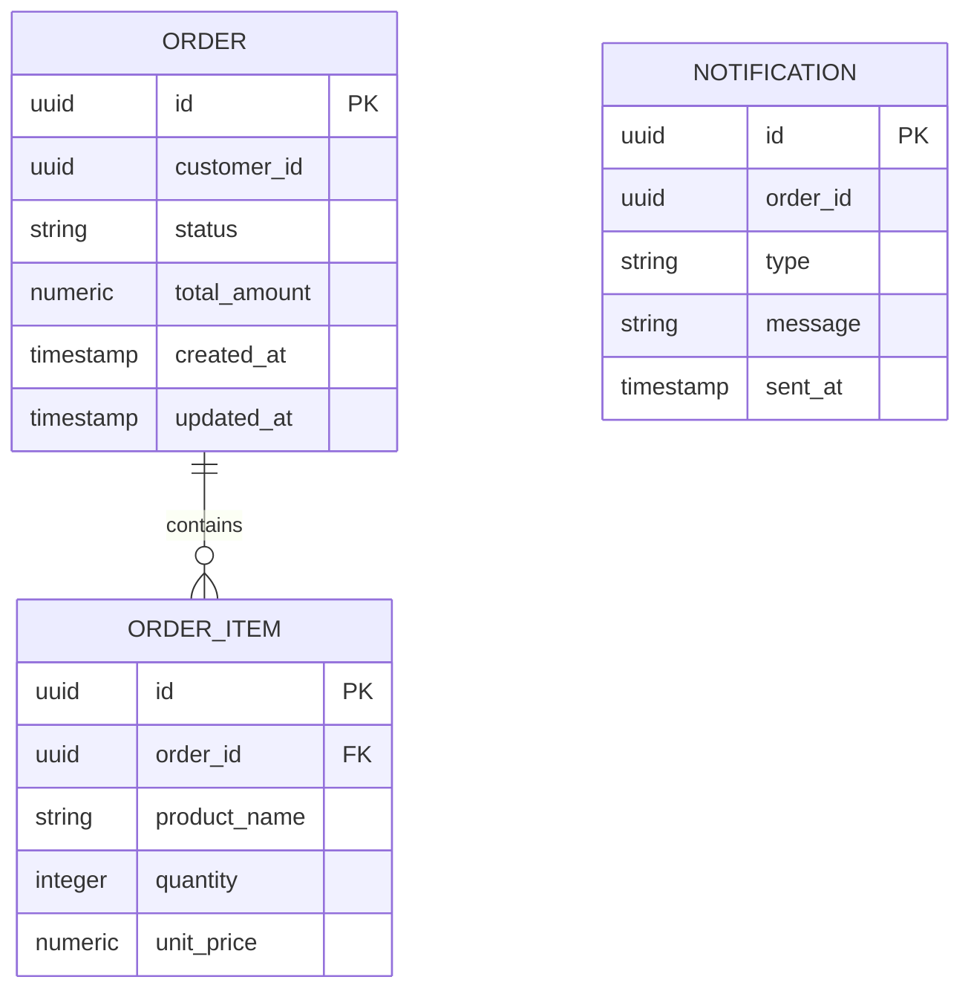

# Order Notification Service

[](https://www.oracle.com/java/)
[](https://spring.io/projects/spring-boot)
[](https://www.rabbitmq.com/)
[](https://www.postgresql.org/)
[](#)

[Português](#portuguese) | [English](#english)

---

<a name="portuguese"></a>

## Português

O **Order Notification Service** é uma API REST para gerenciamento de pedidos onde cada transição de status publica eventos assíncronos no RabbitMQ, os quais são consumidos para gerar registros de notificação.

O frontend que consome esta API está em [order-notification-frontend](https://github.com/MarcioRosendoF/order-notification-frontend).

### Tecnologias

- **Java 21**
- **Spring Boot 3**
- **Spring Data JPA**
- **PostgreSQL 15**
- **RabbitMQ + Spring AMQP**
- **Flyway Migration**
- **Bean Validation**
- **SpringDoc OpenAPI (Swagger)**
- **Testcontainers**
- **JUnit 5 + Mockito**
- **Lombok**

### Estrutura do Projeto

```text
src/main/java/com/marcio/ordernotification/
├── config/       # Configuração do RabbitMQ, filas e Jackson
├── controller/   # Endpoints REST (Orders e Notifications)
├── dto/          # Java Records para Request/Response
├── exception/    # Tratamento global de exceções
├── messaging/    # Produtor de eventos, consumidor e definição de payloads
├── model/        # Entidades JPA (Order, OrderItem, Notification) e Enums
├── repository/   # Repositórios JPA
└── service/      # Regras de negócio e transições de status
```

### Modelagem de Banco de Dados (Diagrama ER)

O banco de dados relacional é estruturado a partir da seguinte modelagem física, ilustrando a relação entre pedidos, itens e as notificações de evento:



### Endpoints da API

#### Orders

- `POST /orders` — Cria um novo pedido com itens e calcula o valor total.
  ```json
  {
    "customerId": "3fa85f64-5717-4562-b3fc-2c963f66afa6",
    "items": [
      {
        "productName": "Notebook",
        "quantity": 1,
        "unitPrice": 3500.00
      }
    ]
  }
  ```
- `GET /orders/{id}` — Retorna o pedido detalhado por ID.
- `GET /orders` — Lista pedidos com paginação e filtro opcional por `status` (PENDING, CONFIRMED, CANCELLED).
- `PATCH /orders/{id}/status` — Atualiza o status do pedido.
  ```json
  {
    "status": "CONFIRMED"
  }
  ```

#### Notifications

- `GET /notifications` — Lista as notificações geradas de forma assíncrona, com paginação e filtro opcional por `orderId`.

### Decisão Arquitetural: Persistência de Logs (Opção B)

Para gerenciamento de logs, foi implementado o arquivo `logback-spring.xml` com a estratégia de persistência física através de **Rolling Files** (Opção B) no perfil de produção, ao invés do fluxo direto para o console padrão (Opção A). 

Essa escolha foi motivada pela necessidade de auditoria independente e isolada dos logs locais da aplicação sem a obrigação imediata de acoplar ferramentas ou coletores de logs externos (como ELK stack ou Prometheus/Loki). Os arquivos são rotacionados a cada 10MB com limite histórico de 100MB.

### Como Executar

1. **Pré-requisitos:** Java 21 e Docker / Docker Compose.
2. **Subir os serviços (PostgreSQL e RabbitMQ):**
   ```bash
   docker compose up -d
   ```
3. **Executar a aplicação:**
   ```bash
   ./mvnw spring-boot:run
   ```
4. **Documentação Swagger UI:**
   Acesse [http://localhost:8080/swagger-ui/index.html](http://localhost:8080/swagger-ui/index.html) para interagir com os endpoints.

---

<a name="english"></a>

## English

The **Order Notification Service** is a REST API for order management where each status transition publishes asynchronous events to RabbitMQ, which are then consumed to generate notification records.

The frontend that consumes this API lives in [order-notification-frontend](https://github.com/MarcioRosendoF/order-notification-frontend).

### Tech Stack

- **Java 21**
- **Spring Boot 3**
- **Spring Data JPA**
- **PostgreSQL 15**
- **RabbitMQ + Spring AMQP**
- **Flyway Migration**
- **Bean Validation**
- **SpringDoc OpenAPI (Swagger)**
- **Testcontainers**
- **JUnit 5 + Mockito**
- **Lombok**

### Project Structure

```text
src/main/java/com/marcio/ordernotification/
├── config/       # RabbitMQ queues, exchanges, bindings and Jackson config
├── controller/   # REST Controllers (Orders and Notifications)
├── dto/          # Java Records for Request/Response
├── exception/    # Global exception handler and custom exceptions
├── messaging/    # Event producers, consumers and event models
├── model/        # JPA Entities (Order, OrderItem, Notification) and Enums
├── repository/   # JPA Repositories
└── service/      # Business logic and status transitions
```

### Database Model (Entity Relationship Diagram)

The relational database schema is structured as follows, illustrating the relationships between orders, items, and event-driven notifications:


### API Endpoints

#### Orders

- `POST /orders` — Create a new order with items and calculate total amount.
  ```json
  {
    "customerId": "3fa85f64-5717-4562-b3fc-2c963f66afa6",
    "items": [
      {
        "productName": "Notebook",
        "quantity": 1,
        "unitPrice": 3500.00
      }
    ]
  }
  ```
- `GET /orders/{id}` — Get order details by ID.
- `GET /orders` — List orders with pagination and optional filter by `status` (PENDING, CONFIRMED, CANCELLED).
- `PATCH /orders/{id}/status` — Update order status.
  ```json
  {
    "status": "CONFIRMED"
  }
  ```

#### Notifications

- `GET /notifications` — List asynchronously created notifications with pagination and optional `orderId` filter.

### Architectural Decision: Log Persistence (Option B)

For logging configuration, a `logback-spring.xml` file has been implemented, defining a physical rolling file strategy (Option B) for the production profile instead of standard console-only output streams (Option A).

This decision ensures local auditability of application logs independently, without requiring immediate integration of external log collection services (such as ELK or Loki). Logs are rotated at 10MB per file with a historical cap of 100MB.

### How to Run

1. **Requirements:** Java 21 and Docker / Docker Compose.
2. **Start external services (PostgreSQL and RabbitMQ):**
   ```bash
   docker compose up -d
   ```
3. **Run the application:**
   ```bash
   ./mvnw spring-boot:run
   ```
4. **Swagger UI Documentation:**
   Open [http://localhost:8080/swagger-ui/index.html](http://localhost:8080/swagger-ui/index.html) to interact with the API.
